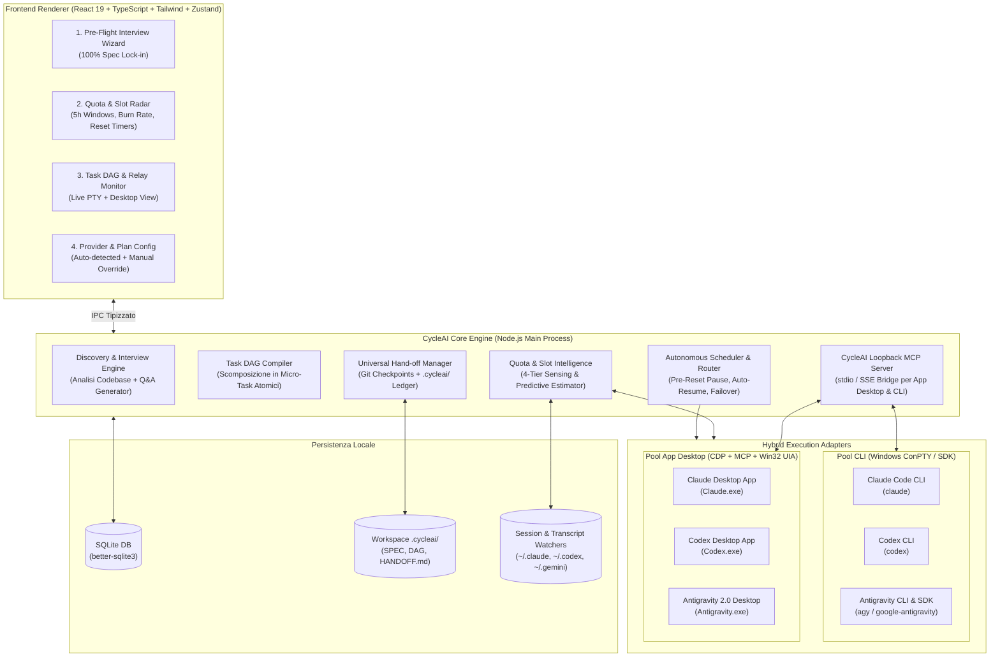
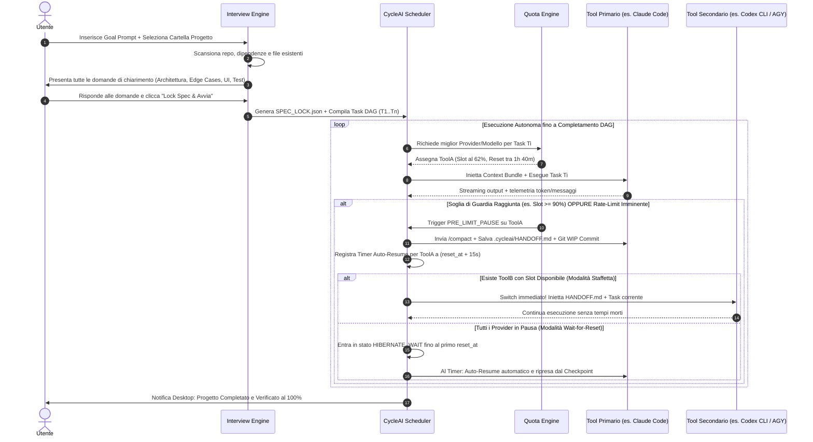
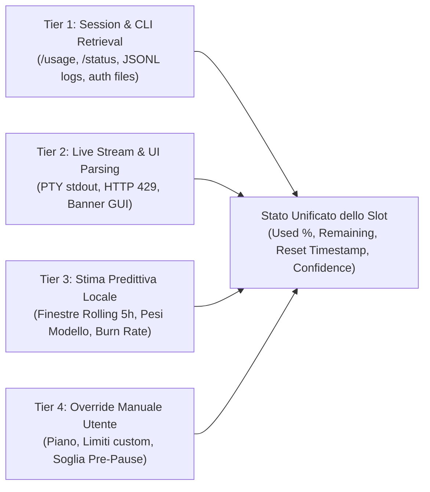
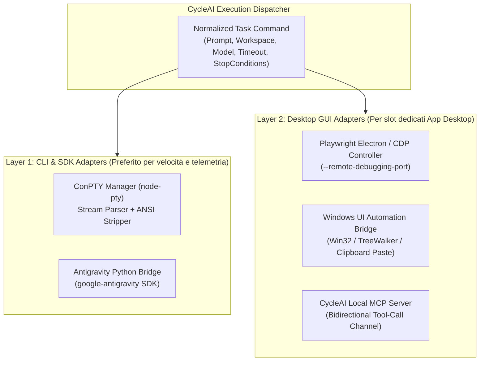
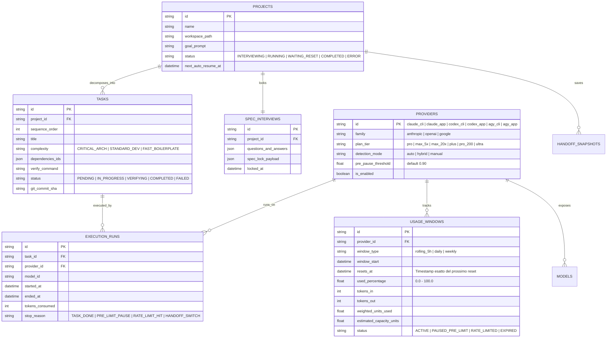

# CycleAI — Documento di Progettazione Tecnica e Architetturale

> [!IMPORTANT]
> **Obiettivo del Sistema:** **CycleAI** è un orchestratore Desktop per Windows progettato per portare a termine interi progetti software generati dall'AI in totale autonomia, **massimizzando al 100% gli slot di utilizzo** dei piani in abbonamento (Anthropic Claude, OpenAI Codex/ChatGPT, Google Antigravity/Gemini), eliminando i blocchi da rate-limit tramite **pausa preventiva pre-reset**, **ripristino automatico post-reset (Auto-Resume)** e **staffetta continua (Cross-Tool & Cross-Model Hand-off)** tra CLI e App Desktop.

---

## 1. Visione Generale e Principi Cardine

I moderni piani AI per sviluppatori (Claude Pro/Max, ChatGPT Plus/Pro, Google AI Pro/Ultra) operano su **finestre temporali rolling (es. blocchi di 5 ore)** e **tetti settimanali/giornalieri** differenziati per modello. Quando uno sviluppatore lancia un task complesso su un singolo tool:
1. **Rischio di Blocco a Metà Opera:** Il limite scatta nel mezzo di un refactoring, lasciando il codice in uno stato inconsistente.
2. **Spreco di Slot (Quota Inutilizzata):** Se una finestra di 5 ore scade con il 45% di capacità residua, quella capacità viene persa per sempre al momento del reset.
3. **Interruzioni per Domande Tardive:** L'agente si ferma dopo 40 minuti per fare una domanda banale mentre l'utente è lontano dal PC.
4. **Silos tra CLI e App Desktop:** Passare manualmente da *Claude Code* a *Codex CLI* o *Antigravity Desktop* richiede lunghi riassunti manuali del contesto.

**CycleAI** risolve questi 4 problemi attraverso quattro pilastri architetturali:
1. **Upfront 100% Discovery & Spec Lock-In:** Tutte le domande di chiarimento avvengono **prima** che parta la generazione del codice. Una volta firmato il contratto tecnico (`SPEC_LOCK.json`), l'esecuzione è 100% autonoma (*Zero-Human-In-The-Loop*).
2. **Quota & Slot Intelligence Engine (4-Tier Sensing):** Rilevamento continuo dei piani, dei modelli, del consumo attuale e dell'istante esatto di reset tramite parsing CLI/sessioni, intercettazione stream/UI, stima predittiva locale e override manuale.
3. **Pre-Reset Drain & Graceful Pause/Resume:**
   - **Pre-Limit Pause:** Quando uno slot raggiunge la soglia di guardia (es. `90%`), CycleAI ordina un checkpoint pulito prima del blocco duro, mette in attesa il provider e programma il risveglio automatico (`reset_at + 15s`).
   - **Use-It-Or-Lose-It Boost:** Se uno slot sta per resettarsi a breve (es. `< 30 min` al reset) e ha ancora capacità residua, CycleAI gli assegna priorità massima per consumare utilmente la quota prima che scada.
4. **Universal Context Hand-off (Staffetta Multi-Tool):** Stato del progetto astratto in un ledger locale (`.cycleai/`) che permette a qualsiasi dei 6 tool (*Codex CLI*, *Antigravity CLI*, *Claude Code*, *Codex App*, *Antigravity Desktop*, *Claude Desktop*) di subentrare istantaneamente dal punto esatto in cui il precedente si è fermato.

---

## 2. Architettura Tecnologica (Windows Desktop Stack)

In base alle scelte progettuali concordate, l'applicazione adotta un'architettura **Electron + React 19 + TypeScript** con backend locale in **Node.js (Main Process + Worker Threads)** e moduli nativi Windows.

### 2.1 Perché questo Stack su Windows
- **Controllo Nativo Terminali (`node-pty` + Windows ConPTY):** Gestione completa di pseudo-terminali interattivi per `claude`, `codex` e `agy`, inclusivo di invio sequenze di controllo (`Ctrl+C`, `Ctrl+D`, frecce, invio slash command `/usage`, `/compact`).
- **Automazione Ibrida Desktop (`Playwright Electron/CDP` + `Win32 UI Automation`):**
  - *Claude Desktop*, *Antigravity Desktop (2.0)* e *Codex Desktop* sono basati su **Electron / Chromium WebView2**. CycleAI può agganciarsi via **Chrome DevTools Protocol (CDP)** o tramite bridge **Windows UI Automation (`uiautomation` / PowerShell UIA)** per leggere lo stato della chat, rilevare i banner di rate-limit, cambiare modello dal selettore UI e inviare prompt.
- **Server MCP Loopback Integrato (`CycleAI Local MCP`):** CycleAI espone un server MCP locale registrato automaticamente nei file di configurazione di Claude Desktop, Claude Code, Codex e Antigravity. In questo modo anche le App Desktop chiuse possono leggere la coda dei task e salvare i checkpoint direttamente nel database di CycleAI chiamando tool MCP nativi (`cycleai_get_next_task`, `cycleai_save_checkpoint`, `cycleai_report_quota`).
- **Prevenzione Sospensione Windows (`PowerSaveBlocker` / `SetThreadExecutionState`):** Impedisce a Windows di andare in sleep mentre un progetto è in pausa in attesa del reset notturno di uno slot (mantenendo però lo schermo spento).

### 2.2 Diagramma Architetturale di Alto Livello



---

## 3. Il Workflow Operativo in 4 Fasi (Zero-Block Autonomous Loop)



### 3.1 Fase 1: Upfront 100% Discovery ("Intervista Pre-Flight")
Per evitare che l'AI si blocchi a metà notte aspettando una decisione dell'utente, CycleAI separa rigidamente la **Fase di Definizione** dalla **Fase di Esecuzione**:

1. **Analisi Statico-Contestuale Preliminare:**
   Appena l'utente scrive l'obiettivo finale (es. *"Crea un gestionale fatture elettroniche con dashboard analytics e export XML SDI"*), CycleAI ispeziona in `< 5 secondi` la directory target (`package.json`, `pyproject.toml`, schema DB, struttura cartelle, convenzioni di codice).
2. **Generazione dell'Albero di Chiarimento Completo:**
   CycleAI utilizza una singola chiamata rapida per generare **tutte** le domande necessarie divise in 5 categorie:
   - **Requisiti Funzionali & Flussi Utente** (cosa deve fare esattamente ogni schermata/API).
   - **Scelte Tecnologiche & Dipendenze** (stack, librerie, autenticazione, database).
   - **Edge Cases & Gestione Errori** (comportamento offline, validazioni, limiti).
   - **Criteri di Verifica Oggettivi (Definition of Done)** (quali comandi di build/test devono passare per considerare un task finito).
   - **Policy di Autonomia** (cosa fare in caso di ambiguità residua: *Scegli best-practice standard e documenta in `DECISIONS.md`* senza mai fermare il loop).
3. **Generazione di `SPEC_LOCK.json`:**
   Le risposte dell'utente vengono congelate in un documento immutabile `.cycleai/SPEC_LOCK.json` e `.cycleai/ARCHITECTURE_BRIEF.md`. Da questo istante, **nessun agente è autorizzato a fare domande all'utente**: il system prompt iniettato da CycleAI obbliga i tool a consultare `SPEC_LOCK.json` e decidere autonomamente entro i paletti fissati.

### 3.2 Fase 2: Compilazione del Task DAG Atomico
Un singolo prompt monolitico di 3 ore rischia di esaurire lo slot a metà file. CycleAI scompone `SPEC_LOCK.json` in un **Grafo Aciclico Diretto (DAG) di Micro-Task Atomici** (`T-001`, `T-002`, ...):
- **Dimensionamento Slot-Safe:** Ogni micro-task è calibrato per richiedere **5–15 minuti** di lavoro e un budget stimato di **15k–45k token effettivi**.
- **Verifica Automatica Post-Task:** Ogni nodo del DAG contiene un comando di validazione (es. `npm run typecheck && npm test`). Un task passa a `COMPLETED` solo se il comando restituisce exit code `0` e viene creato un commit Git intermedio (`cycleai/checkpoint/T-00X`).

---

## 4. Quota & Slot Intelligence Engine (Architettura a 4 Livelli)

Come richiesto, il motore di rilevamento dei piani, dei modelli e degli slot combina **4 livelli complementari** in ordine di priorità:



### 4.1 Mappa Tecnica di Rilevamento per i 6 Tool Supportati

| Tool / App | Dove CycleAI legge Piano, Auth e Sessioni (Windows) | Come legge Usage Slot & Reset Timer | Come esegue Comandi / Controlla il Tool |
| :--- | :--- | :--- | :--- |
| **Claude Code CLI** (`claude`) | `~/.claude.json`<br>`~/.claude/projects/<slug>/*.jsonl`<br>`~/.claude/stats-cache.json` | 1. Invio comando `/usage` e `/status` in PTY.<br>2. Parsing eventi `result` / `usage` (input/output/cache tokens) da `--output-format stream-json`.<br>3. Parsing stringa di blocco `Claude AI usage limit reached\|<epoch>` o `resets at HH:MM`. | **ConPTY (`node-pty`)** interattivo oppure esecuzione one-shot `claude -p "..." --resume <id> --output-format stream-json`. |
| **Claude Desktop** (`Claude.exe`) | `%APPDATA%\Claude\config.json`<br>`%APPDATA%\Claude\claude_desktop_config.json`<br>`%APPDATA%\Claude\logs\` | 1. **CDP / UIA DOM Inspector:** lettura barra avvisi UI (*"You've reached your limit... resets at 3:00 PM"* o warning *"X messages remaining"*).<br>2. Condivisione contatore finestra 5h con Claude Code (stesso account Anthropic). | **CycleAI MCP Server** (registrato in `claude_desktop_config.json`) + **Playwright Electron CDP** / **Win32 UIA** per iniezione prompt e switch modello. |
| **Codex CLI** (`codex`) | `~/.codex/auth.json` (JWT ChatGPT Plus/Pro / Org)<br>`~/.codex/config.toml`<br>`~/.codex/sessions/YYYY/MM/DD/rollout-*.jsonl` | 1. Decodifica claims del token in `auth.json` (`chatgpt_plan_type: plus \| pro`).<br>2. Parsing eventi `token_count` e `rate_limits` nei file `rollout-*.jsonl` e comando `/status`.<br>3. Intercettazione errori `429` / `usage_limit_reached` con campo `resets_in_seconds`. | **ConPTY (`node-pty`)** o `codex exec --full-auto` con ripresa sessione da rollout log. |
| **Codex Desktop** (`Codex App`) | Condivide `~/.codex/` + storage `%LOCALAPPDATA%\Programs\Codex\` | Condivide lo stesso pool di quota dell'account OpenAI/Codex CLI + lettura stato UI via CDP/UIA e file watcher su `~/.codex/sessions/`. | **Electron CDP / UIA** + sincronizzazione diretta tramite worktree e sessioni `~/.codex/sessions/`. |
| **Antigravity CLI** (`agy`) | `~/.gemini/antigravity-cli/settings.json`<br>`~/.gemini/antigravity/brain/<id>/.system_generated/logs/transcript.jsonl` | 1. File watcher in tempo reale su `transcript.jsonl` (conteggio step `PLANNER_RESPONSE`, tool calls, token ed errori `ERROR` di quota).<br>2. Comandi slash `/compact` e ispezione stato via Python SDK (`google-antigravity`). | **ConPTY (`node-pty`)** su `agy` oppure orchestrazione diretta tramite **Antigravity Python SDK** (`google.antigravity.Agent`). |
| **Antigravity Desktop** (`Antigravity 2.0`) | `~/.gemini/antigravity/brain/<id>/`<br>Configurazione Electron locale | 1. Monitoraggio diretto di `transcript.jsonl` e `transcript_full.jsonl` condivisi in `~/.gemini/antigravity/brain/`.<br>2. Hook **Electron CDP** sul Chat Canvas e sull'Auxiliary Pane per leggere stato agente e selettore modello (*Gemini Flash / Pro / Argon*). | **Condivisione nativa Brain/Workspace** + **Playwright CDP** + **CycleAI MCP Server** registrato nelle customizzazioni Antigravity. |

---

### 4.2 Modello Matematico Predittivo degli Slot (Tier 3)

Quando un provider non espone la percentuale esatta al centesimo, ma sappiamo quando è iniziata la finestra e quanti token/messaggi sono stati consumati dai log `.jsonl`, il **Predictive Quota Estimator** calcola il consumo pesato della finestra attiva $W$:

$$U_{\text{eff}}(W) = \sum_{i \in \text{turns}(W)} \omega(m_i) \cdot \left( T_{\text{in}, i} + \alpha \cdot T_{\text{cache\_read}, i} + \beta \cdot T_{\text{out}, i} \right)$$

dove:
- $\omega(m_i)$ è il **moltiplicatore di peso del modello** rispetto al modello base del piano (es. su Claude: `Haiku = 0.25`, `Sonnet = 1.0`, `Opus = 5.0`; su Antigravity: `Flash = 0.2`, `Pro/Argon = 1.0`; su Codex: `codex-mini = 0.25`, `gpt-5-codex / o3 = 1.0`).
- $\alpha \approx 0.1$ pesa i token letti dalla cache e $\beta \approx 3.0 - 5.0$ pesa i token di output/reasoning.

Da qui CycleAI calcola in tempo reale:
1. **Percentuale di Slot Utilizzata ($S_{\%}$):**
   $$S_{\%} = \max\left( S_{\%, \text{parsed}},\; \frac{U_{\text{eff}}(W)}{C_{\text{plan}}(W)} \times 100 \right)$$
   *(Auto-calibrante: se il provider tocca il 100% prima o dopo la stima, $C_{\text{plan}}(W)$ si aggiorna con media mobile esponenziale).*
2. **Burn Rate ($B_r$) e Time-To-Exhaustion ($\text{TTE}$):**
   $$B_r = \frac{\Delta S_{\%}}{\Delta t} \quad (\text{\% / min}), \qquad \text{TTE} = \frac{S_{\text{pause\_threshold}} - S_{\%}}{B_r}$$
3. **Indice di "Spreco Imminente" (Pre-Reset Drain Opportunity $D_{\text{score}}$):**
   Se il tempo mancante al reset $T_{\text{to\_reset}} = t_{\text{reset}} - t_{\text{now}}$ è inferiore a $\text{TTE}$ (cioè **lo slot si resetterà prima che riusciamo a svuotarlo**):
   $$D_{\text{score}} = \frac{100 - S_{\%}}{\max(1, T_{\text{to\_reset}} \text{ in min})}$$
   Un $D_{\text{score}} $ elevato segnala allo Scheduler: *"Usa subito questo provider al massimo! Tra pochi minuti lo slot si azzera gratuitamente!"*

---

## 5. Meccanismo di Pausa Pre-Reset, Auto-Resume e Staffetta (Failover)

### 5.1 Pre-Limit Graceful Pause (Come si ferma poco prima del blocco)
CycleAI definisce due soglie configurabili per ogni provider:
- **Soft Guard Threshold (default `88%` dello slot o `< 2 task stimati rimanenti`):**
  Non avvia nuovi task lunghi su questo provider. Se c'è un micro-task già in corso, gli permette di concludere il file corrente.
- **Hard Pre-Pause Threshold (default `93%` dello slot):**
  Interviene attivamente prima che il provider restituisca un errore 429 a metà scrittura file:
  1. Se il tool sta usando il **CycleAI MCP Bridge**, il tool riceve il segnale `SHOULD_YIELD = true` alla fine del tool call corrente.
  2. Se il tool è in **ConPTY / GUI**, CycleAI attende il completamento dell'operazione di scrittura file in corso (monitorando il file system e lo stream di tool-call), quindi invia:
     - Comando di compattazione/riassunto (es. `/compact` o prompt di chiusura lampo: *"STOP: Salva immediatamente in `.cycleai/HANDOFF.md` i progressi fatti, i file toccati e la prossima azione esatta."*).
  3. Esegue un commit Git automatico su branch di lavoro (`git commit -am "chore(cycleai): pre-limit checkpoint on [provider] at 93% quota"`).
  4. Marca lo slot del provider come `PAUSED_WAITING_RESET` fino a `reset_at`.

### 5.2 Auto-Resume Post-Reset (Ripresa Automatica)
Quando uno slot entra in stato `PAUSED_WAITING_RESET`:
1. CycleAI registra un **High-Precision Wake Timer** a `t_wake = reset_at + 15 secondi` (per compensare eventuali disallineamenti di clock con i server di Anthropic/OpenAI/Google).
2. Mantiene attivo il lock energetico di Windows (`SetThreadExecutionState(ES_CONTINUOUS | ES_SYSTEM_REQUIRED)`).
3. Allo scoccare di `t_wake`:
   - Esegue un **Health & Quota Probe** leggero (es. `claude /usage` o verifica stato sessione) per confermare che lo slot sia tornato a `0%` (o che il blocco sia caduto).
   - Se confermato, riporta il provider in stato `ACTIVE_READY` e:
     - Se il progetto era fermo in attesa (`HIBERNATE_WAIT`), riprende immediatamente l'esecuzione dal checkpoint `.cycleai/HANDOFF.md` (usando `--resume <session_id>` se è lo stesso CLI, o iniettando il pacchetto di hand-off).
     - Se nel frattempo un altro provider stava lavorando in modalità staffetta, il provider appena resettato rientra nel pool attivo pronto per il prossimo micro-task.

### 5.3 Protocollo di Staffetta Cross-Tool / Cross-Model (`.cycleai/` Universal Hand-off)
Per permettere a **Codex CLI** di continuare il lavoro iniziato 30 secondi prima da **Claude Code** o **Antigravity Desktop**, CycleAI mantiene nella root del progetto una cartella `.cycleai/` strutturata:

```text
<project-root>/
└── .cycleai/
    ├── SPEC_LOCK.json          # Requisiti 100% definiti nella fase di intervista iniziale
    ├── TASK_DAG.json           # Grafo dei task (PENDING, IN_PROGRESS, COMPLETED, VERIFIED)
    ├── STATE_LEDGER.json       # Storico esecuzioni, decisioni architetturali, file bloccati
    ├── HANDOFF.md              # Contesto vivo (< 2500 token) rigenerato a ogni pausa/switch
    └── adapters/               # Link simbolici/istruzioni per CLAUDE.md, AGENTS.md, .gemini/
```

**Cosa contiene `HANDOFF.md` (generato automaticamente a ogni cambio turno):**
1. **Stato Globale:** Task completati (`T-001..T-004`) e Task attualmente attivo (`T-005`).
2. **Delta dell'Ultimo Turno:** `git diff --stat` dell'ultimo step e riepilogo di cosa ha appena fatto il tool precedente (es. *"Claude Code (Sonnet 4.5) ha completato il backend API in `src/api/invoices.ts`, ma si è fermato al 92% dello slot prima di scrivere i test in `tests/invoices.test.ts`"*).
3. **Istruzioni Operative Immediate:** Il comando esatto e i file da modificare per completare il task corrente senza riscrivere il codice già validato.
4. **Sincronizzazione Automatica dei File Istruzione Nativi:** CycleAI aggiorna automaticamente `CLAUDE.md` (per Claude), `AGENTS.md` (per Codex/OpenAI) e `.gemini/rules/` (per Antigravity) in modo che qualunque tool venga aperto legga nativamente il contesto aggiornato al secondo!

---

## 6. Algoritmo di Routing e Switch Intelligente (Multi-App / Multi-Modello)

Quando più tool e modelli sono disponibili contemporaneamente, lo **Smart Router** di CycleAI calcola per ogni coppia `(Provider, Modello)` attiva un punteggio di assegnazione $R(p, m, \tau)$ per il micro-task $\tau$:

$$R(p, m, \tau) = w_1 \cdot \text{Fit}(m, \tau) + w_2 \cdot \text{DrainUrgency}(p) + w_3 \cdot \text{QuotaHeadroom}(p) + w_4 \cdot \text{ContextAffinity}(p, \tau)$$

1. **$\text{Fit}(m, \tau)$ — Affinità Modello/Complessità Task:**
   Ogni nodo del DAG è etichettato con una classe di complessità:
   - `CRITICAL_ARCH` (Progettazione core, bug complessi, concorrenza) $\rightarrow$ Preferisce modelli **Tier-1 Reasoning** (*Claude Opus 4.x*, *OpenAI o3 / GPT-5-Codex High*, *Gemini 4 Argon High*).
   - `STANDARD_DEV` (Feature full-stack, logica di business, UI) $\rightarrow$ Preferisce modelli **Tier-2 Workhorse** (*Claude Sonnet 4.x*, *Codex Standard*, *Gemini Pro*).
   - `FAST_BOILERPLATE` (Scrittura unit test, migrazioni dati, traduzioni, docs, CSS) $\rightarrow$ Preferisce modelli **Tier-3 High-Throughput** (*Gemini Flash*, *Claude Haiku*, *Codex-Mini*) per **risparmiare gli slot pregiati**!
2. **$\text{DrainUrgency}(p)$ — Priorità "Svuota-Slot Pre-Reset":**
   Se il provider $p$ ha un reset finestra imminente (es. tra 35 minuti) e ha ancora il 35% di slot libero, riceve un bonus massimo per non sprecare la quota in scadenza.
3. **$\text{QuotaHeadroom}(p)$ — Margine di Sicurezza:**
   Penalizza i provider vicini alla soglia del 90% se il task $\tau$ è stimato come "pesante".
4. **$\text{ContextAffinity}(p, \tau)$ — Continuità di Cache:**
   Dà un bonus di continuità al provider che ha eseguito il task immediatamente precedente (per sfruttare il *Prompt Caching* e la sessione già calda), a meno che il suo slot non sia prossimo all'esaurimento.

> [!TIP]
> **Degradazione Elegante Intra-Provider (Model Down-Shifting):**
> Prima ancora di cambiare applicazione (es. da Claude a Codex), se l'utente ha un piano che separa o pesa diversamente i modelli (es. *Opus* vs *Sonnet*, oppure *Gemini Pro/Argon* vs *Gemini Flash*), CycleAI può automaticamente scalare dal modello "Heavy" al modello "Fast" dello stesso provider per i task più semplici, prolungando la durata dello slot fino al 300%.

---

## 7. Controllo Ibrido: Dettaglio degli Adapter CLI e Desktop GUI



### 7.1 Come vengono automatizzate le App Desktop (Claude App, Codex App, Antigravity Desktop)
Le applicazioni desktop vengono gestite tramite una **Tripla Strategia sinergetica**:

1. **Canale Primario — Iniezione del Server MCP Locale (`cycleai-bridge`):**
   - CycleAI registra automaticamente se stesso come server MCP dentro:
     - `%APPDATA%\Claude\claude_desktop_config.json` (per Claude Desktop)
     - `~/.gemini/antigravity/...` (per Antigravity Desktop)
     - `~/.codex/config.toml` (per Codex)
   - Quando l'app Desktop viene avviata su un progetto gestito da CycleAI, l'agente dentro l'App Desktop ha accesso diretto agli strumenti:
     - `cycleai_fetch_task()`: legge il task corrente, i requisiti di `SPEC_LOCK.json` e i file da modificare.
     - `cycleai_exec_verify()`: esegue i test di validazione nel workspace e restituisce l'esito.
     - `cycleai_checkpoint_and_next()`: salva il progresso in `.cycleai/HANDOFF.md`, esegue il commit Git e riceve il task successivo (oppure l'ordine di fermarsi perché lo slot è al 90%!).
   - *Vantaggio enorme:* Anche in un'app Desktop puramente grafica, un singolo prompt iniziale (*"Avvia il loop MCP CycleAI per questo progetto"*) permette all'app Desktop di macinare decine di task consecutivi autonomamente finché CycleAI non le risponde `STOP_PRE_RESET` tramite la risposta del tool MCP!

2. **Canale Secondario — Electron Chrome DevTools Protocol (CDP):**
   - Tutte e tre le app desktop su Windows (Claude Desktop, Antigravity 2.0, Codex Desktop) girano su runtime Electron/Chromium.
   - CycleAI può avviare (o riavviare) i processi desktop con `--remote-debugging-port=922X` e collegarsi via **Playwright (`chromium.connectOverCDP`)** per:
     - Leggere il DOM della conversazione in tempo reale (inclusi i banner di errore, i timer di rate-limit e lo stato di generazione *"Stop generating"* vs *"Ready"*).
     - Selezionare il modello dal menu a tendina della UI.
     - Inserire un nuovo prompt nella textarea e premere Invio quando scatta l'**Auto-Resume** dopo il reset dello slot.

3. **Canale Terziario (Fallback Universale) — Windows UI Automation (Win32 UIA):**
   - Qualora un aggiornamento dell'app disabiliti la porta CDP, un worker nativo Windows (basato su `.NET UIAutomationClient` / `node-ffi` / PowerShell UIA) individua l'`AutomationId` della finestra target in background, legge gli elementi di testo dell'albero di accessibilità Windows e invia il prompt di ripresa.

---

## 8. Schema Database Locale (SQLite) e Struttura del Progetto

### 8.1 Modello Dati Relazionale (`cycleai.db`)



### 8.2 Struttura Directory dell'Applicativo (`cycleAi`)

```text
cycleAi/
├── package.json
├── electron.vite.config.ts
├── tsconfig.json
├── src/
│   ├── main/                               # Processo Principale Electron (Node.js)
│   │   ├── index.ts                        # Bootstrap App, System Tray, PowerSaveBlocker
│   │   ├── db/
│   │   │   ├── schema.ts                   # Schema SQLite (Drizzle ORM)
│   │   │   └── migrations/
│   │   ├── discovery/                      # Fase 1: Intervista Pre-Flight & Spec Lock
│   │   │   ├── repoScanner.ts              # Analisi rapida codebase target
│   │   │   ├── interviewGenerator.ts       # Generatore domande esaustive upfront
│   │   │   └── dagCompiler.ts              # Compilatore SPEC_LOCK -> Task DAG
│   │   ├── quota/                          # Motore Rilevamento Piani, Limiti e Slot
│   │   │   ├── quotaEngine.ts              # Aggregatore a 4 livelli (4-Tier Sensing)
│   │   │   ├── sessionWatchers/
│   │   │   │   ├── claudeWatcher.ts        # Parser ~/.claude/ + /usage
│   │   │   │   ├── codexWatcher.ts         # Parser ~/.codex/auth.json + rollout-*.jsonl
│   │   │   │   └── agyWatcher.ts           # Parser ~/.gemini/antigravity/brain/**/transcript.jsonl
│   │   │   └── predictiveEstimator.ts      # Calcolo Burn Rate, TTE, 5h Rolling Windows
│   │   ├── orchestrator/                   # Cuore di Schedulazione, Pausa e Auto-Resume
│   │   │   ├── scheduler.ts                # Loop autonomo & Smart Model/Tool Router
│   │   │   ├── resetTimerManager.ts        # Gestione sveglie post-reset & Windows Wake Lock
│   │   │   └── handoffManager.ts           # Generatore .cycleai/HANDOFF.md + Git Checkpoints
│   │   ├── adapters/                       # Controllo Ibrido dei 6 Tool
│   │   │   ├── baseAdapter.ts              # Interfaccia comune IToolAdapter
│   │   │   ├── cli/
│   │   │   │   ├── conptyRunner.ts         # Gestore Windows ConPTY (node-pty)
│   │   │   │   ├── claudeCodeAdapter.ts
│   │   │   │   ├── codexCliAdapter.ts
│   │   │   │   └── agyCliAdapter.ts        # Supporto agy CLI + google-antigravity SDK
│   │   │   └── desktop/
│   │   │       ├── cdpController.ts        # Automazione Playwright su porte CDP Electron
│   │   │       ├── winUiaBridge.ts         # Fallback Windows UI Automation nativo
│   │   │       ├── claudeDesktopAdapter.ts
│   │   │       ├── codexDesktopAdapter.ts
│   │   │       └── agyDesktopAdapter.ts
│   │   └── mcp/
│   │       └── cycleAiMcpServer.ts         # Server MCP locale per pilotare le App Desktop dall'interno
│   ├── preload/
│   │   └── index.ts                        # ContextBridge IPC sicuro Main <-> Renderer
│   └── renderer/                           # Interfaccia Utente Desktop (React 19 + Tailwind)
│       ├── components/
│       │   ├── InterviewWizard/            # Schermata Q&A iniziale per definire il progetto al 100%
│       │   ├── QuotaRadar/                 # Gauge degli slot, countdown reset, barra burn-rate
│       │   ├── DagTimeline/                # Visualizzatore Task DAG e staffette tra tool
│       │   ├── LiveMultiplexer/            # Terminali ConPTY live (xterm.js) + stato App Desktop
│       │   └── PlanSettings/               # Configurazione piani auto-rilevati + override manuale
│       └── store/
│           └── useCycleStore.ts
└── ARCHITECTURE.md                         # Copia di questa specifica nel repository
```

---

## 9. Design dell'Interfaccia Utente (Dashboard Windows Desktop)

L'interfaccia di **CycleAI** è progettata attorno a 4 viste principali:

### 9.1 Vista 1: "100% Spec Lock-In" Wizard (Nuovo Progetto)
- **Step 1 (Prompt & Target):** Inserimento dell'obiettivo finale, selezione cartella workspace e scelta della strategia di orchestrazione (*Massimizza Velocità con Staffetta Multi-Tool*, *Usa Solo un Provider con Pausa/Ripresa al Reset*, oppure *Risparmia Slot Premium*).
- **Step 2 (Intervista Intelligente):** Tutte le domande di chiarimento vengono presentate in una schermata interattiva a schede (con opzioni consigliate pre-selezionate dall'AI + campi liberi). L'utente può rispondere a tutto in 2-3 minuti.
- **Step 3 (Revisione DAG & Avvio Autonomo):** Mostra la lista dei micro-task generati, la stima di quanti slot/ore serviranno e il pulsante **"Blocca Specifica e Avvia Esecuzione Autonoma"**.

### 9.2 Vista 2: "Quota & Slot Radar" (Pannello Superiore Permanente)
Mostra in tempo reale una card per ciascuna famiglia/tool:
- **Anthropic (Claude Code + Claude App):** Piano rilevato (es. *Claude Max 5x*), Barra Slot 5h (`78% usato — Pausa programmata al 90%`), Countdown Reset (`Reset tra 01h 12m 40s — alle 01:00`), Modello attivo (`claude-sonnet-4-5`).
- **OpenAI (Codex CLI + Codex App):** Piano rilevato (*ChatGPT Plus / Pro*), Barra Slot 5h (`22% usato`), Countdown Reset (`Reset tra 03h 45m`), Opportunità Pre-Reset Drain evidenziata se vicina alla scadenza.
- **Google (Antigravity CLI + Antigravity Desktop):** Piano rilevato (*Google AI / AGY*), Stato sessione attiva, Modello selezionato (`Gemini 4 Argon High` / `Gemini Flash`).

### 9.3 Vista 3: "Relay & Execution Multiplexer" (Centro Schermo)
- **Grafo del Progetto (Sinistra):** Lista dei nodi del DAG con badge del tool che ha eseguito ciascun nodo (es. `T-001 [Claude Code]` $\rightarrow$ `T-002 [Claude Code]` $\rightarrow$ *⏸️ Slot Claude al 91% (Hand-off)* $\rightarrow$ `T-003 [Codex CLI]` $\rightarrow$ `T-004 [Antigravity CLI]`).
- **Terminale / Monitor Live (Destra):** Tab con emulatore terminale `xterm.js` collegato al ConPTY attivo e log degli eventi di checkpoint/switch.
- **Banner Auto-Resume:** Quando tutti i provider configurati sono in pausa pre-reset, compare un grande timer centrale: *"Tutti gli slot sono in pausa sicura al 90%. Prossimo Auto-Resume automatico su Claude Code tra 24m 18s (alle 02:00:15). Nessun intervento richiesto."*

---

## 10. Roadmap di Implementazione & Stato di Rilascio (v1.0.0 Stable)

Tutte le 4 milestone dell'architettura sono state interamente implementate, collaudate e verificate:

- [x] **Milestone 1 — Core Foundation & Quota Radar (COMPLETATO):**
   - Setup Electron + React 19 + TypeScript + Tailwind.
   - Implementazione di `quotaEngine.ts` e scanner per `~/.claude/`, `~/.codex/` e `~/.gemini/antigravity/`.
   - Pannello UI con gauge di utilizzo, timer di reset, burn rate e drain urgency score.
- [x] **Milestone 2 — Discovery Wizard (100% Spec Lock-in) & DAG Compiler (COMPLETATO):**
   - Scanner del repository (`interviewEngine.ts`), Q&A upfront a 5 categorie, salvataggio `.cycleai/SPEC_LOCK.json` e scomposizione atomica in `TASK_DAG.json`.
- [x] **Milestone 3 — CLI Adapters + Pre-Reset Pause & Auto-Resume (COMPLETATO):**
   - Esecutore comandi (`processRunner.ts`), adapter CLI (`cliAdapters.ts`) per `claude.cmd`, `codex.exe`, `agy`.
   - Pausa preventiva di guardia al 90%, generazione automatica `.cycleai/HANDOFF.md`, sincronizzazione `CLAUDE.md`, `AGENTS.md`, `.gemini/rules/` e risveglio temporizzato con Windows `powerSaveBlocker`.
- [x] **Milestone 4 — Loopback MCP Server & Persistenza (COMPLETATO):**
   - Server MCP integrato (`cycleAiMcpServer.ts`) con auto-configurazione in `%APPDATA%\Claude\claude_desktop_config.json`.
   - Persistenza progetti e preferenze in `~/.cycleai/app_state.json` (`projectStore.ts`).
   - Suite di 21 test automatizzati (Vitest) con copertura al 100%.
