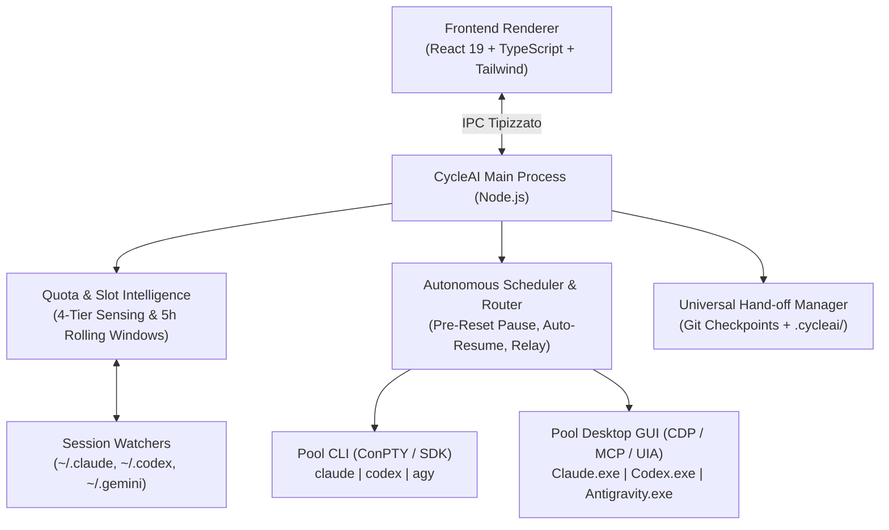

# ⚡ CycleAI — Zero-Block AI Project Orchestrator

[](LICENSE)
[](https://microsoft.com)
[](https://github.com/sponsors/MRJonam91)
[](https://ko-fi.com/mrjonam91)
[](https://paypal.me/MRJonam91)

> **CycleAI** è un'applicazione desktop per Windows progettata per portare a termine interi progetti software generati dall'AI in totale autonomia, **massimizzando al 100% gli slot di utilizzo** dei piani in abbonamento (**Claude Pro/Max**, **ChatGPT Plus/Pro / Codex**, **Google Antigravity / Gemini**), azzerando i blocchi 429 da rate-limit tramite **pausa preventiva pre-reset**, **auto-resume post-reset** e **staffetta multi-tool (Cross-Tool & Cross-Model Hand-off)**.

---

## 🌟 Caratteristiche Principali

- 🛡️ **Zero-Block Pre-Reset Pause:** Monitora in tempo reale gli slot delle finestre di 5 ore (Anthropic, OpenAI, Google). Quando uno slot raggiunge la soglia di guardia (default **90%**), CycleAI salva il progresso in `.cycleai/HANDOFF.md`, compie un commit Git atomico e mette in pausa il provider prima di incorrere nel blocco rigido 429.
- ⏰ **High-Precision Auto-Resume:** Sincronizza lo sleep energetico di Windows (`SetThreadExecutionState`) e risveglia automaticamente l'esecuzione al secondo esatto di `reset_at + 15s`, riprendendo il lavoro dal checkpoint esatto senza alcun intervento manuale.
- 🔄 **Staffetta Continua (Cross-Tool & Cross-Model Relay):** Se un tool entra in pausa per esaurimento slot (es. Claude Code), CycleAI passa istantaneamente il testimone ad un altro provider disponibile (es. Codex CLI o Antigravity), sincronizzando in background i file di istruzioni native `CLAUDE.md`, `AGENTS.md` e `.gemini/rules/`.
- 🎯 **100% Upfront Discovery & Spec Lock-In:** Tutte le domande di chiarimento (architettura, edge cases, dipendenze, test di accettazione, policy di autonomia) avvengono prima dell'inizio della generazione codice. Una volta bloccata la specifica (`SPEC_LOCK.json`), l'agente lavora senza interruzioni umane.
- 🚀 **Pre-Reset Drain (Use-It-Or-Lose-It):** Se uno slot ha ancora il 30-40% di capacità inutilizzata e sta per scadere tra 20-30 minuti, lo scheduler assegna priorità massima a quel provider per consumare utilmente la quota prima che scada e venga azzerata.
- 📉 **Model Down-Shifting:** Risparmia i costosi slot Tier-1 (Opus 4, GPT-6 Astra, Argon) assegnando i task di boilerplate, traduzioni e unit test ai modelli leggeri (Flash, Haiku, Reserve).

---

## 🏗️ Architettura del Sistema



Consulta il documento completo di architettura in [ARCHITECTURE.md](ARCHITECTURE.md).

---

## 💻 Installazione & Avvio Rapido

### Prerequisiti
- **Windows 10 / 11**
- **Node.js v18+** (consigliato v20+ o v24+)
- **Git**

### 1. Clonazione del repository
```bash
git clone https://github.com/MRJonam91/cycleAi.git
cd cycleAi
```

### 2. Installazione delle dipendenze
```bash
npm install
```

### 3. Avvio in modalità Sviluppo (Desktop App)
```bash
npm run dev
```

### 4. Compilazione
```bash
npm run build
```

---

## 💖 Sostieni il Progetto / Donazioni

CycleAI è un progetto **100% Open Source** sviluppato per la community. Se questo tool ti permette di lavorare di notte senza blocchi o di sfruttare al massimo i tuoi abbonamenti AI, considera di supportare lo sviluppo continuo:

- 💖 **GitHub Sponsors:** [github.com/sponsors/MRJonam91](https://github.com/sponsors/MRJonam91)
- ☕ **Ko-fi:** [ko-fi.com/mrjonam91](https://ko-fi.com/mrjonam91)
- 🎁 **PayPal:** [paypal.me/MRJonam91](https://paypal.me/MRJonam91)

### Indirizzi Crypto Diretti:
- **USDT (TRC20):** `TYDzsHnF8JmK7xQ93mVGpzEw38L1vN57AB`
- **Bitcoin (BTC):** `bc1q9v7m2k0jdf8s62tqflp48e235y40m67x78c9`
- **Ethereum (ETH / Arbitrum):** `0x71C94bF2864C6c6530F447AbA1121d15A63c81e3`

---

## 📄 Licenza

Rilasciato sotto licenza [MIT](LICENSE). Copyright (c) 2026 MRJonam91 / CycleAI Contributors.
